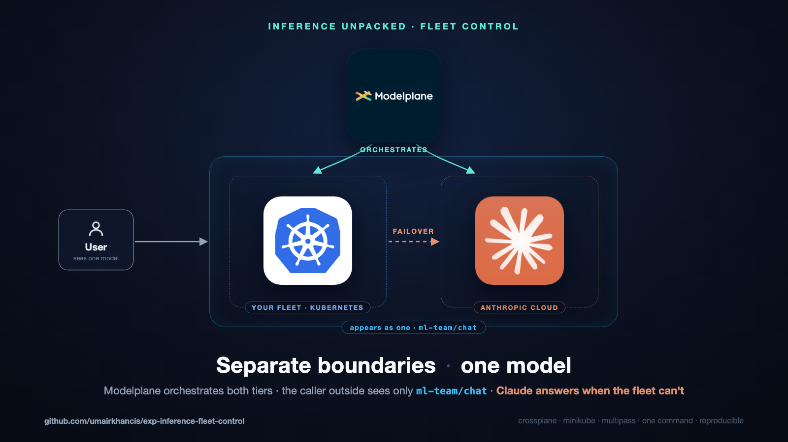

# Controlling a Fleet of Inference Clusters with Modelplane

A Modelplane control cluster managing a BYO inference cluster, all in
Multipass VMs; one OpenAI-compatible model name — **`ml-team/chat`** —
served by the fleet's own Qwen replica first, with Claude as a transparent
failover. Callers never see which tier answered.

## Architecture



**Requires:** Apple Silicon Mac, 24GB RAM, ~40GB disk, [Homebrew](https://brew.sh).
Everything else is installed for you; all compute stays inside the VMs.
Optional: an `ANTHROPIC_API_KEY` for the Claude failover tier (stored only
as a Secret on the control cluster, never committed).

## Quick setup — one command

```sh
export ANTHROPIC_API_KEY=sk-ant-...   # optional: enables the Claude failover tier

curl -fsSL https://raw.githubusercontent.com/umairkhancis/exp-inference-fleet-control/main/install.sh | bash
```

~45–60 min on first run. Safe to rerun — every layer is idempotent.

## Manual setup — step by step

```sh
git clone https://github.com/umairkhancis/exp-inference-fleet-control.git
cd exp-inference-fleet-control

make host-prereqs          # 0. multipass, kubectl, helm, jq
make control-cluster       # 1. "modelplane" VM + minikube (the control cluster)
make modelplane            # 2. Crossplane + Modelplane Configuration
make inference-cluster-1   # 3. fleet cluster: VM + MetalLB, registered + Ready
make models                # 4. qwen on the fleet (ml-team/qwen-cpu)
make chat                  # 5. ml-team/chat: fleet first, Claude failover
make verify                # 6. trace one request through every hop
```

Raw kubectl equivalents live next to the manifests:
[inference-cluster-1](manifests/platform-team/inference-cluster-1/README.md) ·
[qwen-cpu](manifests/ml-team/qwen-cpu/README.md) ·
[chat](manifests/ml-team/chat/README.md).

## Use it

```sh
./client/gateway-tunnel.sh                         # gateway -> localhost:8080 (keep running)

./client/chat.sh "What is the capital of France?"  # raw curl client
python3 client/chat.py --who                       # stdlib-only Python client
```

- Control plane: `kubectl --context modelplane get ic,ig,md,ms -A`
- Fleet state: `make status`

## Prove the failover

```sh
make failover    # with the tunnel running in another shell
```

Each request prints `asked for -> served by`: the fleet's qwen answers,
the engine pod is killed and the *same* requests are answered by Claude,
then the fleet recovers and takes traffic back.

## Park and resume

```sh
make stop && make start   # VMs parked with all state; resumed to serving
```

## Tear down

```sh
make down
```
